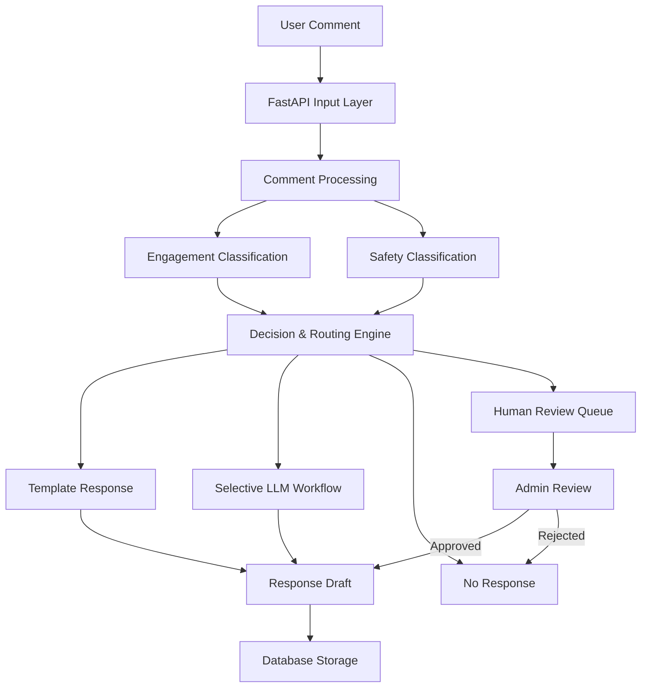

# MODERAI – Hybrid AI-Powered Comment Moderation System

MODERAI is a hybrid AI-powered comment moderation system designed to classify user comments, evaluate harmful content, and make moderation decisions through an intelligent routing workflow.

Instead of relying on a single model, MODERAI combines machine learning classification, safety detection, decision logic, and human-in-the-loop review to support more controlled and context-aware comment moderation.

## Key Features

- **Engagement Classification:** Categorizes comments into Positive, Negative, Neutral, Critical, and Question.
- **Safety Detection:** Evaluates comments across toxicity, obscene content, threats, insults, identity attacks, and sexually explicit content.
- **Hybrid Decision Engine:** Routes comments based on engagement classification, safety signals, and decision rules.
- **Automated Response Templates:** Supports predefined responses for suitable positive comments.
- **Selective LLM Workflow:** Provides a simulated LLM response-generation workflow for selected comments.
- **Human-in-the-Loop Review:** Routes uncertain or sensitive comments for manual review.
- **Approval-Controlled Responses:** Supports reviewing and approving or rejecting response drafts before use.

## System Architecture

## Technology Stack

| Component | Technologies |
|---|---|
| Backend | Python, FastAPI |
| Machine Learning | Scikit-learn, TF-IDF, Logistic Regression |
| Safety Classification | ML-based safety classifiers |
| Database | SQLite, SQLAlchemy |
| Frontend | React, TypeScript |
| Testing | Pytest |
| API | REST APIs |

## How It Works

1. A user comment enters the system through the API.
2. The comment is processed and passed to the classification components.
3. The engagement classifier predicts the comment category.
4. Safety classifiers evaluate potentially harmful content.
5. The decision engine combines classification outputs and routing rules.
6. The system selects an appropriate action:
   - Generate a predefined template response.
   - Route to the simulated LLM workflow.
   - Take no response action.
   - Send the comment to the human review queue.
7. Response drafts can be reviewed and approved or rejected.

## Project Design Principles

- Hybrid intelligence instead of depending on a single classifier.
- Safety-aware decision making.
- Selective use of response generation.
- Human oversight for uncertain or sensitive cases.
- Separation of classification, decision making, and response handling.

## Project Status

MODERAI is an actively developed project. Its current implementation includes ML-based classification, safety detection, decision routing, and human review workflows. The LLM response-generation workflow is currently simulated rather than connected to a live LLM service.

## Future Improvements

- Integrate a live LLM response-generation service.
- Improve classification performance and decision thresholds.
- Expand multilingual moderation capabilities.
- Add monitoring and analytics for moderation decisions.
- Evaluate the system on additional real-world datasets.

---

**MODERAI** – Building safer and more intelligent comment moderation workflows.